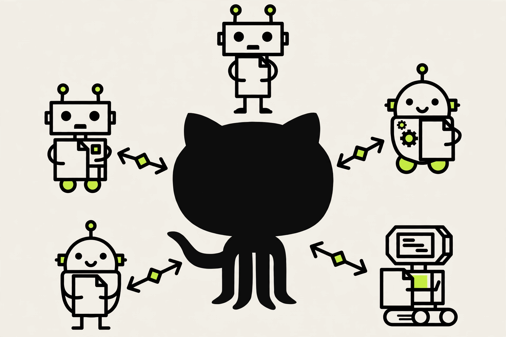

Don't be afraid of GitHub

In the last post I claimed the tools are easy to start and hard to leave, because the context stays behind. This is how I moved the context out.

For the first weeks I used AI tools, I fed each one everything about how I work. My projects, my preferences, the decisions I had already made.

Each tool kept what I told it. None of them told the others. When I opened a second tool, I started from zero again.

That is five tools holding five different versions of me. Each one confident, each one incomplete, each one quietly going stale the moment I stopped talking to it. The more I used them, the more of my own context I had scattered across apps I do not control.

So I moved the memory out of the tools entirely, into files I own.

## The shared folder

Think of GitHub the way you think of a shared Drive folder. That is all it is, text files and folders, nothing else. My context is files and folders. Code is files and folders too. That is why it fits.

## The loop

Developers share one codebase through GitHub. My agents share one context the same way. Every agent works with a local copy of the same repository. Each one reads the context through AGENTS.md, which tells it where everything lives. When an agent learns something new, it pushes the change back. The next agent refreshes and picks it up. Nothing is re-explained, nothing is lost when I switch tools.

The repo holds 484 files now, read by five tools. Muse, Instinct, Copilot, Perplexity, Claude.

## You do not need to learn GitHub

You do not need to know how GitHub works. Just tell the agent to create the repository and follow a few conventions. The conventions are the interesting part, and they get their own post.

The conventions post is next. DM me if you want help getting started.

#employablepm #employablepm. #ProductManagement #AgenticAI #AIAgents.

