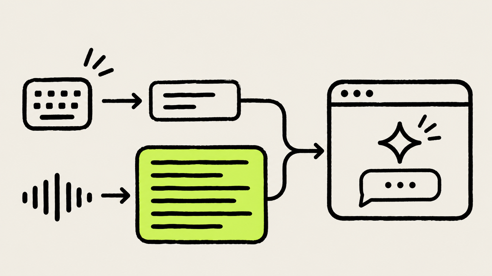

I would start typing a request to an AI and try to make it concise.

Then I’d remove the background. Cut the example. Rewrite the sentence so it sounded like a prompt instead of the half-formed thought I actually had.

The result looked efficient on my screen. It also left out details that would have helped the model understand what I was asking.

I’ve changed that part of my workflow with local voice-to-text. I use Handy to speak directly into the application I’m already using. It runs locally, doesn’t spend model tokens on transcription, and works across applications.

I don’t stop to fix every misspelling or missing word. I can say what happened, what I’ve tried, what constraint matters, and what I’m unsure about in the time it used to take me to type a much shorter prompt.

The model can help organize a messy explanation. An agent can use the details I gave it to take a more useful next step. Neither can work with context I edited out before sending.

This is the first article in a mini-series about tools I use with AI. Handy is a small tool with a bigger effect on my setup: it makes giving the model more of my thinking feel easy enough to do by default.

I’ll add links to Handy and the solution here later.

My one lesson: spend less effort polishing the input and more effort giving the model the context.

